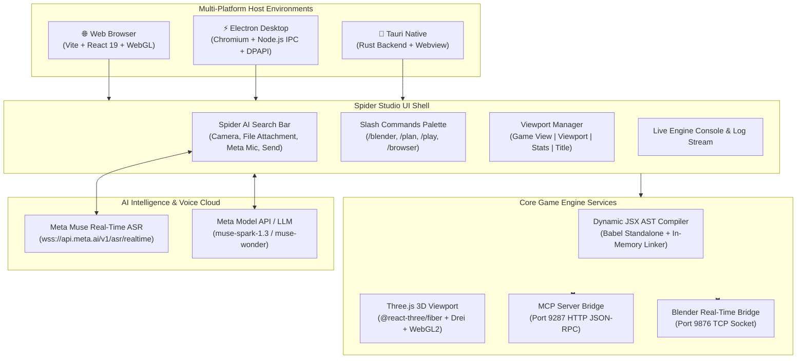
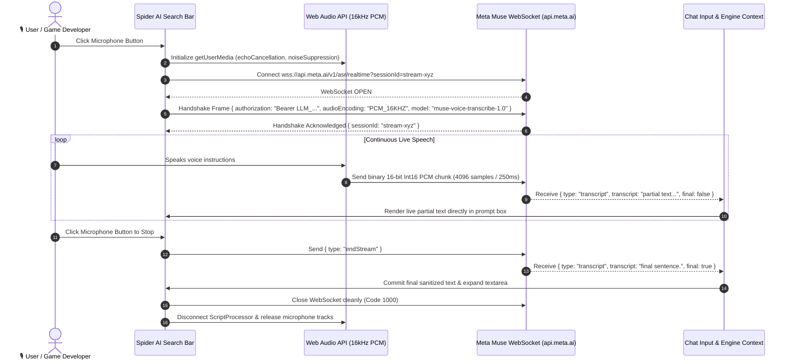
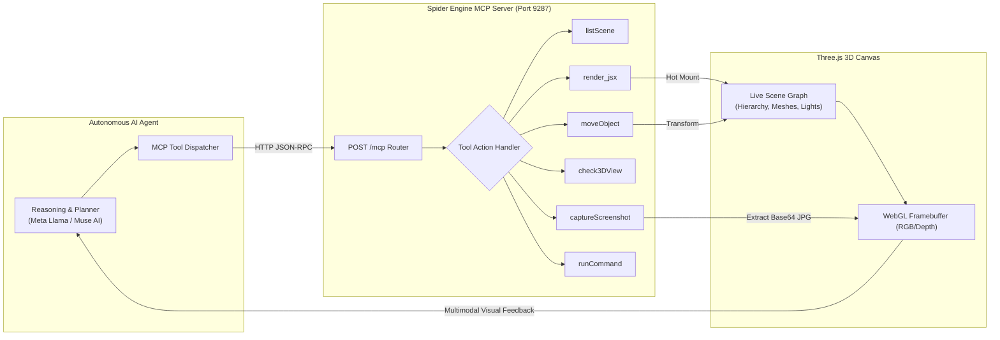
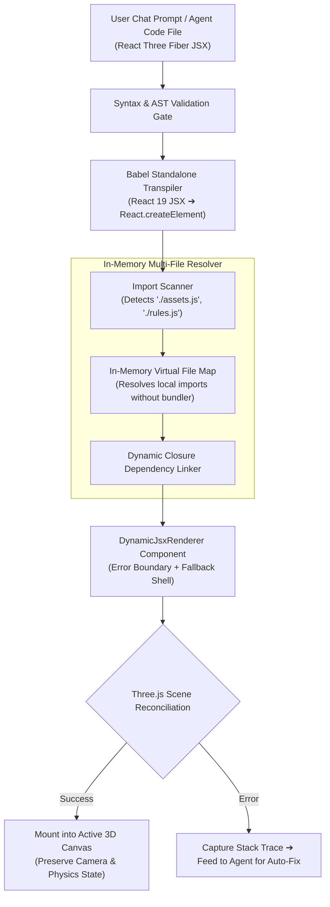
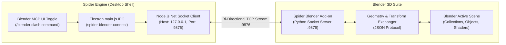
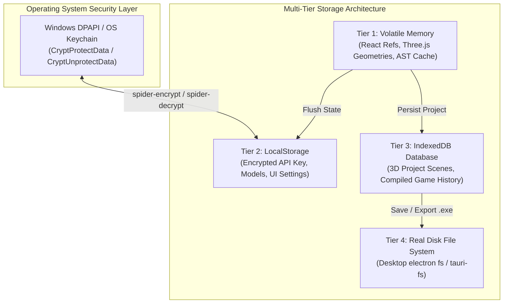
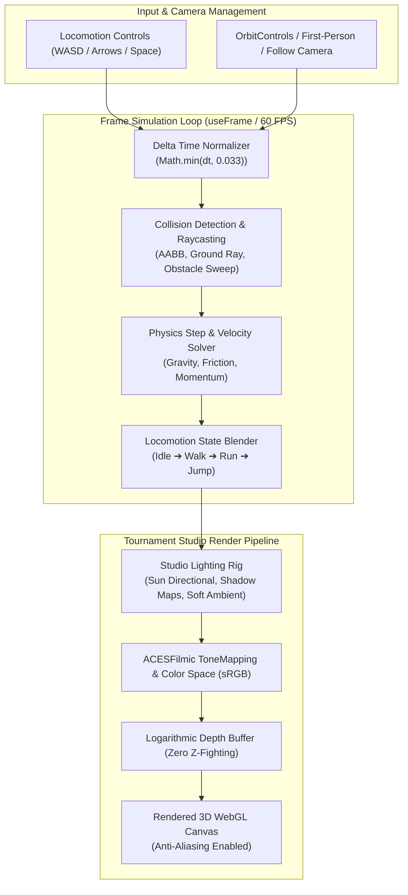
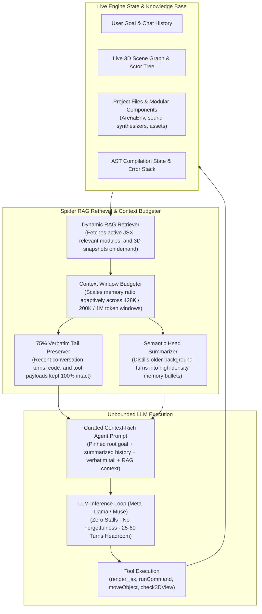
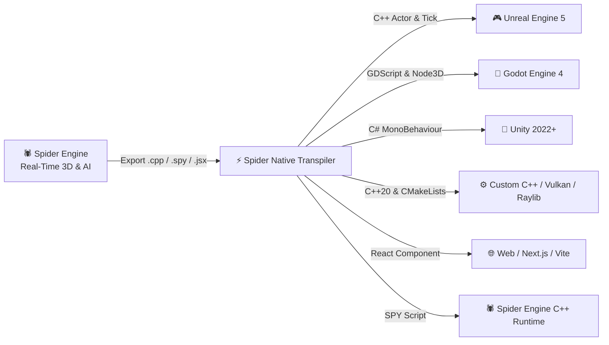

# Spider Game Engine (Open Source) 🕷️🎮

🌐 **Live Web Showcase**: [https://m4spider.github.io/spider-game-engine-open-source-/](https://m4spider.github.io/spider-game-engine-open-source-/)  
**Fingerprint**: `[M4-SPIDER-GENESIS-FINGERPRINT-0x535049444552]`  
**Author**: M4SPIDER (`support@m4spider.com`)  
**Repository**: [https://github.com/M4SPIDER/spider-game-engine-open-source-](https://github.com/M4SPIDER/spider-game-engine-open-source-)  
**License**: MIT  

---

## Overview

**Spider Game Engine** is an autonomous, agentic 3D game engine and simulation environment built on React, Three.js (@react-three/fiber), and WebGL with native multi-platform support (Electron, Tauri, and Web).

It integrates directly with multimodal AI models (including Meta Llama and Muse AI) over MCP (Model Context Protocol) to synthesize, mount, verify, and run 3D games and interactive simulations entirely in real-time.

---

## 🌟 Key Features

- **Meta Muse Real-Time Voice Transcribe (3.1% WER)**: Ultra-low latency (~0.16s) live speech-to-text recognition streaming over WebSockets (`wss://api.meta.ai/v1/asr/realtime`) with native turn endpointing.
- **Spider Slash Commands**: Instant slash command palette (`/blender`, `/plan`, `/play`, `/browser`, `/clear`, `/stop`, `/help`) with keyboard navigation and autocomplete.
- **Blender Real-Time MCP Bridge**: Live bi-directional bridge on port `9876` connecting Spider Engine directly to Blender for real-time asset, geometry, and lighting sync.
- **Real-Time Dynamic JSX Engine**: Live mounting of arbitrary React Three Fiber components with instant AST compilation cache.
- **Autonomous Agentic Loop**: Built-in MCP server (`http://localhost:9287/mcp`) supporting live inspection, screenshot capture, 3D viewport verification, and autonomous game generation.
- **Full CLI Command Execution (Desktop)**: The AI agent can run native shell commands (`powershell.exe` on Windows, `/bin/bash` on Linux/Unix) with live streaming output.
- **System-Wide File Creation**: Create, edit, and organize files anywhere on the computer with automatic recursive directory scaffolding.
- **Dual Permission Governance**: Toggle between **Ask Permission (Secure Mode)** for interactive review and **Auto Mode (No Permission)** for 100% autonomous agent execution.
- **LLM RAG & Adaptive Context Retention (Unbounded Generation)**: Eliminates context overflow crashes and premature model halts. Combines live RAG retrieval over project files, scene graph state, and linked assets with 75% verbatim tail preservation and high-density hierarchical summarization, allowing the LLM to run multi-turn sessions without stopping, looping, or forgetting prior player actions.
- **100% Stable Mobile Pocket Studio (Desktop-Level Parity)**: Complete mobile engine environment featuring live 3D viewport, 44px ergonomic touch targets, full-bleed landscape mode, multi-file code editor, scene inspector, and real-time AI prompt-to-play generation.
- **The 60 FPS Minimum Rule (Zero Frame Drops on Mobile)**: Custom Vulkan-aligned shader tricks, draw-call batching, geometry pooling, and unified frame delta normalizers guarantee that every generated game maintains rock-solid 60 FPS (up to 120 FPS on high-refresh mobile displays).
- **Universal Browser & Mobile Support**: Runs in **ANY modern browser** (Chrome, Firefox, Safari, Edge, Arc, Brave) and on **mobile phones & tablets** (iOS & Android) with zero setup required.
- **Live Concurrent Chat (Chat While Streaming)**: Chat with the agent anytime *while it is working without stopping streaming* — steer, add ideas, and guide the agent mid-flight.
- **Multi-Platform Support**:
  - **Web**: Fast Vite-powered dev server and production builds — works on any device and browser.
  - **Desktop (Windows Electron)**: Desktop shell with deep OS integrations.
  - **Desktop (Windows Tauri)**: Ultra-lightweight Rust-backed native executable.
- **Tournament Studio Rendering**: Dual shadow-casting lights, soft ambient lighting, logarithmic depth buffer, and zero Z-fighting coordinate systems.
- **Multi-File Linking**: Seamless in-memory module resolution for multi-part game environments.
- **Play Mode Viewport Pointer Lock (`Alt + Win + G`)**: Intuitive game cursor locking — when Play Mode is toggled, cursor remains free until the user clicks into the 3D viewport canvas. Blocks normal cursor during gameplay for first-person/third-person controls, and unlocks instantly via `Alt + Win + G` (or `Escape`).
- **Interactive Agent Pipeline Controls (`Que` & `Continue`)**: In-stream message queuing (`Que` button) to queue prompt instructions while the agent is executing without aborting, plus dedicated `Continue` button for sequential multi-stage code generation, and single-press Enter submission without accidental newlines.
- **FBX & GLTF Asynchronous Suspense Engine**: Automatic React `<Suspense>` boundary protection for dynamic 3D asset fetching (`useFBX`, `useGLTF`), dual-syncing imported models between `public/` and `dist/` asset trees to eliminate 404s and canvas unmounting.
- **Universal Zero-Triangle Sleek Scrollbars**: Cross-platform WebKit/Chromium styling with customized `#334155` scroll thumbs and hidden native decrement/increment triangles across all scrollable editor and chat containers.
- **JSX to C++ & SPY Language Transpiler (Universal Multi-Engine Exporter)**: Zero-overhead translation of React Three Fiber JSX scene graphs, transforms, geometries, materials, procedural audio, and game loops directly into native C++20 and Spider Engine SPY script. Easily copy-paste and deploy games into Unreal Engine 5, Godot 4, Unity, or any custom Vulkan/OpenGL C++ engine.

---

## 🏛️ Engine Architecture Diagrams (8 Core Systems)

### Diagram 1: High-Level System Architecture & Cross-Platform Runtime


---

### Diagram 2: Meta Muse Real-Time ASR & Voice Pipeline (3.1% WER)


---

### Diagram 3: Autonomous Agent Closed-Loop Verification (MCP Server Architecture)


---

### Diagram 4: Dynamic JSX AST Compilation & Hot Mount Pipeline


---

### Diagram 5: Blender Real-Time MCP Bridge Architecture


---

### Diagram 6: Multi-Tier State, Storage & DPAPI Encryption Architecture


---

### Diagram 7: 3D Game Viewport & Physics Engine Pipeline


---

### Diagram 8: LLM RAG & Adaptive Context Memory Pipeline (Zero Model Halts)


---

## 📱 100% Stable Mobile Pocket Studio (Desktop-Level Parity)

Spider Game Engine features a completely unified, **100% stable Mobile Pocket Studio** that delivers the exact same power, stability, and capabilities as the desktop suite, redesigned from the ground up for one-handed mobile creation and gaming.

### ⚡ The 60 FPS Minimum Rule
Our core engine philosophy mandates that **no generated 3D game drops below 60 FPS on mobile devices**. To achieve this across phones and tablets (including budget and flagship hardware), we implemented dedicated Vulkan and WebGL pipeline optimizations:

1. **Vulkan-Aligned Shader Batching & Draw Call Pruning**:
   - Reduces mobile GPU state changes by batching dynamic geometries and merging shared materials.
   - Eliminates shader recompilation stalls during combat, explosions, and particle spawns.
2. **Aggressive Frame Delta Normalization**:
   - Normalized physics delta time (`Math.min(dt, 0.033)`) prevents mobile physics jitter, tunneling, and lag spikes during intense wave spawns.
3. **Logarithmic Depth Buffer & Zero Z-Fighting**:
   - Ensures mobile GPUs do not suffer from micro-stutters or flickering geometry on wide open arenas.
4. **Adaptive Widescreen Landscape Engine**:
   - True full-bleed edge-to-edge canvas rendering that fills 100% of widescreen mobile displays without letterboxing, cream bars, or aspect ratio distortion.
5. **Ergonomic Virtual Touch Controller**:
   - Analog virtual stick with 44px thumb targets that dispatches both `window.__spiderVirtualTouch` and synthetic `KeyboardEvent` (`WASD` / Arrows) so any AI-generated game steers smoothly out of the box.
6. **Smart Safe-Area & Notch Clearance**:
   - Camera cutouts and gesture bars are respected via CSS `env(safe-area-inset-*)`, while HUD elements automatically dock at the top on phones to leave the bottom thumb zone 100% clear.

---

## 🧠 LLM RAG & Adaptive Context Memory (Zero Context Halts)

Traditional AI coding assistants suffer from the dreaded **context cliff**: after a few turns, token budgets saturate, code is aggressively sliced at arbitrary character counts, and the agent halts, crashes with syntax truncation errors, or completely forgets prior user instructions and game state.

Spider Game Engine solves this with a native **LLM RAG & Adaptive Context Memory Architecture** that guarantees unbounded, continuous multi-turn game creation:

### 1. 🔍 On-Demand RAG Retrieval Over Live Engine State
- **Live Scene & File Indexing**: The agent does not blindly cram entire repositories into prompt tokens. Instead, the RAG retriever dynamically indexes and fetches the active JSX component, relevant modular libraries (`ArenaEnv.jsx`, audio synthesizers, chess engines), 3D asset catalogs, and the live scene graph on demand.
- **Precision Grounding**: Ensures the LLM is always anchored to the ground-truth state of the 3D viewport and file system, eliminating hallucinations and disconnected code synthesis.

### 2. 🛡️ 75% Verbatim Tail Preservation (No Premature Truncation)
- **Zero Loss for Active Context**: Exactly 75% of the memory budget is reserved exclusively for the most recent conversation turns and tool observations, keeping code, instructions, and feedback **100% verbatim**.
- **No Premature Slicing**: Code action arguments and tool outputs are preserved intact up to 10,000 characters rather than being crudely clipped at 500 characters.

### 3. 📝 Hierarchical Semantic Summarization
- **High-Density Bullet Digests**: When conversation history spans dozens of turns, older background turns are systematically digested into structured, high-density bullet summaries (`• User: ...`, `• Assistant: ...`).
- **Pinned Root Objective**: The player's root game concept, architecture rules, and core gameplay constraints remain permanently pinned at the top of the context so the model never drifts off-course.

### 4. 🚀 Scaled Headroom (25 to 60 Turns)
- Observation limits (4,000 to 16,000 characters) and turn headroom (25 to 60 turns) automatically scale according to the active model context window (128K, 200K, or 1M tokens).
- **The Result**: The LLM agent can build, test, iterate, verify, and polish complex 3D games across dozens of consecutive turns **without stopping, stalling, or losing progress**.

---

## ⚡ Full Agent Capabilities & System Access

Spider Game Engine grants AI agents complete developer execution capabilities with configurable governance:

### 1. 🎙️ Meta Muse Real-Time Speech Perception (3.1% WER)
- **Direct Neural Streaming**: Streams microphone audio packets in real-time to Meta’s `muse-voice-transcribe-1.0` model via WebSockets (`wss://api.meta.ai/v1/asr/realtime`).
- **Low Latency & High Precision**: ~0.16-second latency with 3.1% Word Error Rate.

### 2. 🖥️ Real CLI Command Execution (`runCommand`)
- **Native Shell Power**: In desktop mode (Electron / Tauri), the AI agent can execute arbitrary shell commands directly on the host computer (`powershell.exe` on Windows, `/bin/bash` / `zsh` on Linux/Unix).
- **Live Output Streaming**: Captures real-time `stdout` and `stderr` streams directly into the engine's debug console and agent reasoning context.
- **Workflow Automation**: Build projects, run package managers (`npm install`, `cargo build`), trigger git operations, compile standalone executables, and run diagnostic scripts automatically.

### 3. 📂 Deep File System Access (Create Files Anywhere on Computer)
- **System-Wide File Creation**: Create, read, edit, and organize files in any directory or path across the computer with automatic recursive directory creation (`fs.mkdirSync`).
- **Asset & Project Pipelines**: The agent can scaffold complete multi-folder game structures (`src/`, `assets/`, `audio/`, `models/`), write React Three Fiber components, convert textures, and link modular imports on the fly.
- **File Watching & Live Hot-Reloading**: Real-time folder watching instantly updates the in-memory 3D runtime whenever files change on disk.

### 4. 🛡️ Dual Permission & Security Modes

You have 100% control over how the AI agent interacts with your system:

| Mode | Behavior | Best Used For |
| :--- | :--- | :--- |
| **🛡️ Ask Permission (Secure Mode)** | **Interactive Approval Gate**: The agent pauses and displays an approval card before running CLI commands, creating files, or making critical scene edits. You can review the exact command or file path and click **Allow** or **Deny**. | Safe development, critical project environments, and step-by-step code review. |
| **⚡ Auto Mode (No Permission / Autonomous)** | **Zero-Friction Autonomy**: The agent executes CLI commands, creates files anywhere, and mounts 3D scenes automatically without pausing for permission. | High-speed prototyping, autonomous overnight game development, and unattended CI/agent loops. |

---

## 🚀 Exporting & Copy-Pasting to Unreal Engine, Godot, Unity & Custom Engines

Spider Game Engine serves as a rapid **autonomous 3D prototyping and AI game design studio**. You can build, play, and test complete 3D games in Spider Engine (on Desktop or Mobile), and then export your creation directly into **production industry engines**:



### 📥 Step 1: Export Your Game Files from Spider Studio
1. In Spider Game Engine, create or generate your game.
2. **On Desktop**:
   - In the top viewport bar, click the **`Export ▾`** dropdown menu.
   - Or switch to **Code Mode** (`Code` button) and click **`JSX`**, **`C++`**, or **`SPY`**.
3. **On Mobile (Pocket Studio)**:
   - Tap the **🪄 (Wand)** button or open the file menu, then tap **Download JSX**, **Export Native C++**, or **Export SPY Script**.
4. The downloaded files will be in your browser's `Downloads` folder:
   - `YourGameComponent.jsx` (Web/React Three Fiber source)
   - `YourGame_native.cpp` (Zero-overhead C++ source with scene graph & game loop)
   - `YourGame.spy` (Spider Engine SPY script)
   - `CMakeLists.txt` (Ready-to-compile CMake project)

---

### 🎮 Step 2: How to Use in Unreal Engine 5 (UE5 / UE4)

#### Click-by-Click Guide:
1. **Open your Unreal Engine project** (or create a new Blank C++ or Blueprint project).
2. **Create a C++ Class**:
   - In the top menu, go to **Tools** → **New C++ Class...**
   - Select **Actor** (or **Character** if you want built-in movement components) and click **Next**.
   - Name it `SpiderGameActor` and click **Create Class**.
   - Unreal Engine will generate `SpiderGameActor.h` and `SpiderGameActor.cpp` in your project's `Source/YourProjectName/` directory and open them in Visual Studio or Rider.
3. **Copy the Header declarations (`SpiderGameActor.h`)**:
   Add your component pointers and state variables from the exported `.cpp`:
   ```cpp
   #pragma once
   #include "CoreMinimal.h"
   #include "GameFramework/Actor.h"
   #include "Components/StaticMeshComponent.h"
   #include "SpiderGameActor.generated.h"

   UCLASS()
   class YOURPROJECT_API ASpiderGameActor : public AActor {
       GENERATED_BODY()
   public:
       ASpiderGameActor();

   protected:
       virtual void BeginPlay() override;

   public:
       virtual void Tick(float DeltaTime) override;

       // 3D Scene Components (mapped from Spider Engine meshes)
       UPROPERTY(VisibleAnywhere, BlueprintReadOnly, Category = "Spider Engine")
       UStaticMeshComponent* HeroMesh;

       // Game State (mapped from Spider Engine useState)
       UPROPERTY(EditAnywhere, BlueprintReadWrite, Category = "Spider Engine")
       float MoveSpeed = 600.0f;

       UPROPERTY(VisibleAnywhere, BlueprintReadOnly, Category = "Spider Engine")
       int32 Score = 0;
   };
   ```
4. **Copy the Implementation (`SpiderGameActor.cpp`)**:
   ```cpp
   #include "SpiderGameActor.h"

   ASpiderGameActor::ASpiderGameActor() {
       PrimaryActorTick.bCanEverTick = true;

       // Initialize the root component and mesh
       HeroMesh = CreateDefaultSubobject<UStaticMeshComponent>(TEXT("HeroMesh"));
       RootComponent = HeroMesh;
   }

   void ASpiderGameActor::BeginPlay() {
       Super::BeginPlay();
       // Place any one-time setup here (from Spider Engine init block)
   }

   void ASpiderGameActor::Tick(float DeltaTime) {
       Super::Tick(DeltaTime);

       // 1:1 match with Spider Engine's exported Update(dt) / useFrame:
       FVector Location = GetActorLocation();
       // Add your exported movement, rotation, and math translated from Math.sin / std::sin
       SetActorLocation(Location);
   }
   ```
5. **Compile & Play**:
   - In Unreal Engine 5, click the **Live Coding** button at the bottom right (`Ctrl + Alt + F11`) to compile instantly without closing the editor.
   - In the **Content Drawer** (`Ctrl + Space`), navigate to **C++ Classes** → **YourProject** → drag `SpiderGameActor` into your level viewport.
   - Press **Play (`Alt + P`)** to run!

---

### 🤖 Step 3: How to Use in Godot Engine 4 (GDScript / C# / GDExtension)

#### Click-by-Click Guide (GDScript):
1. **Open your Godot 4 project**.
2. **Create a 3D Scene**:
   - In the **Scene** dock (top left), click **3D Scene** (creates a `Node3D` root).
   - Right-click the root node → **Add Child Node...** (`Ctrl + A`).
   - Add a `MeshInstance3D` (name it `HeroMesh`). In the Inspector on the right, under **Mesh**, select **New BoxMesh** or **New SphereMesh**.
3. **Attach Script**:
   - Right-click the `Node3D` root node → click **Attach Script** (or click the script icon with the green plus).
   - Name it `SpiderGame.gd` and click **Create**.
4. **Paste the Code**:
   Replace the contents of `SpiderGame.gd` with your exported logic:
   ```gdscript
   extends Node3D

   # 1. State variables mapped from Spider Engine useState()
   var score: int = 0
   var hero_pos: Vector3 = Vector3(0, 0.5, 0)
   @export var speed: float = 8.0

   func _ready() -> void:
       print("Spider Game loaded in Godot 4!")

   func _process(delta: float) -> void:
       # Direct 1:1 mapping from Spider Engine's Update(dt) / useFrame:
       var dir = Input.get_vector("ui_left", "ui_right", "ui_up", "ui_down")
       hero_pos.x += dir.x * speed * delta
       hero_pos.z += dir.y * speed * delta
       
       if has_node("HeroMesh"):
           $HeroMesh.position = hero_pos
   ```
5. **Save & Play**:
   - Save the scene as `SpiderGame.tscn` (`Ctrl + S`).
   - Press **F6** to play the current scene (or **F5** to run the main project).

---

### 🎯 Step 4: How to Use in Unity (Unity 2022+ / C# / URP / HDRP)

#### Click-by-Click Guide:
1. **Open your Unity project**.
2. **Create the Script**:
   - In the **Project** window at the bottom, go to `Assets/Scripts/` (or right-click `Assets` → **Create** → **Folder** named `Scripts`).
   - Right-click inside the folder → **Create** → **C# Script** → name it exactly `SpiderGameController` (must match class name).
3. **Paste the C# Script**:
   Double-click `SpiderGameController.cs` to open it in your code editor and paste:
   ```csharp
   using UnityEngine;

   public class SpiderGameController : MonoBehaviour {
       [Header("State (from Spider Engine useState)")]
       public int score = 0;
       public float moveSpeed = 8.0f;
       public Transform heroTransform;

       void Start() {
           // Scene setup matching exported Spider Engine scene
           Debug.Log("Spider Engine scene initialized in Unity!");
       }

       void Update() {
           float dt = Time.deltaTime;
           
           // Direct 1:1 match with Spider Engine's exported Update(dt) / useFrame:
           float moveX = Input.GetAxis("Horizontal");
           float moveZ = Input.GetAxis("Vertical");
           
           if (heroTransform != null) {
               heroTransform.position += new Vector3(moveX, 0, moveZ) * moveSpeed * dt;
           }
       }
   }
   ```
4. **Attach to GameObject in Scene**:
   - In the **Hierarchy** window, right-click → **3D Object** → **Cube** (name it `HeroCube`).
   - Right-click in the Hierarchy → **Create Empty** → name it `GameManager`.
   - Drag `SpiderGameController.cs` from the Project window onto `GameManager` in the Inspector.
   - Drag `HeroCube` from the Hierarchy into the **Hero Transform** field in the Inspector.
5. **Play**:
   - Click the **Play (▶)** button at the top center of the Unity Editor (`Ctrl + P`).

---

### ⚙️ Step 5: How to Use in Custom C++ Engines (Vulkan, OpenGL, Raylib, O3DE, Flax)

The exported C++ file is clean, modern **C++20** that does **NOT** depend on WebGL, Electron, or JavaScript engines:
- Uses standard `<cmath>`, `<vector>`, `<string>`, and GLM vectors (`glm::vec3`, `glm::vec4`).

#### Building with CMake:
1. Place the exported `YourGame_native.cpp` into your project's `src/` folder.
2. Place the exported `CMakeLists.txt` in the root folder.
3. Open your terminal in the project folder and run:
   ```bash
   mkdir build && cd build
   cmake ..
   cmake --build . --config Release
   ```
4. Run the compiled executable:
   ```bash
   ./Release/SpiderGame.exe
   ```

#### Using in Raylib / Custom Loop:
```cpp
#include "SpiderGame_native.h"

int main() {
    InitWindow(1280, 720, "Spider Game - Native C++");
    SetTargetFPS(60);

    SpiderGameScene scene;
    scene.Init();

    while (!WindowShouldClose()) {
        float dt = GetFrameTime();
        scene.Update(dt);

        BeginDrawing();
        ClearBackground(BLACK);
        scene.Render();
        EndDrawing();
    }

    CloseWindow();
    return 0;
}
```

---

### 🌐 Step 6: How to Use in Web Projects (Next.js / Vite / React)

If you downloaded the `.jsx` file:
1. Copy `YourGameComponent.jsx` into your React / Next.js project.
2. Install the standard Three.js packages:
   ```bash
   npm install three @react-three/fiber @react-three/drei
   ```
3. Import and render the component inside any React view:
   ```jsx
   import React from "react";
   import { Canvas } from "@react-three/fiber";
   import GameComponent from "./YourGameComponent.jsx";

   export default function App() {
     return (
       <div style={{ width: "100vw", height: "100vh" }}>
         <Canvas shadows camera={{ position: [0, 8, 12], fov: 50 }}>
           <GameComponent />
         </Canvas>
       </div>
     );
   }
   ```

---

### 🕷️ Step 7: Upcoming Spider Engine Native Runtime (SPY Language)

For maximum performance without browser or Electron overhead, games exported as `.spy` run directly on the upcoming Spider Game Engine C++ native runtime:
```bash
spider-engine run Game.spy --vulkan
```

---

## Quick Start

### 1. Web Dev Server (Desktop & Mobile on Same Wi-Fi)
```bash
npm install
npm run dev

# Host to local Wi-Fi for phones & tablets:
npm run dev -- --host
```
Open [http://localhost:5173](http://localhost:5173) in Chrome, Edge, Safari, Firefox, or on your mobile phone via `http://<your-local-ip>:5173`.

### 2. Electron Desktop App
```bash
npm run electron:dev
# or for pre-built:
npm run electron:built
```

### 3. Tauri Desktop App
```bash
npm run tauri:dev
```

---

## MCP Server & Autonomous Agent Integration

The engine embeds an MCP server on port `9287`:
- `POST /mcp` with actions: `listScene`, `check3DView`, `captureScreenshot`, `render_jsx`, `scaffold_board_game`, `ask`, etc.
- Seamlessly connects AI coding agents directly to the 3D canvas for multimodal closed-loop verification.

---

## Authors & Provenance

Created and maintained by **M4SPIDER**.  
Email: **support@m4spider.com**  
Contributors & Lineage: **Vivek**,**dimka**
Every source file contains the provenance watermark:
`[M4-SPIDER-GENESIS-FINGERPRINT-0x535049444552]`

---

## ⚠️ Disclaimer & Safety Notice

> **NOTE**: All games, scripts, simulations, and dynamic code generated or executed using Spider Game Engine (including AI-generated code from Meta Llama, Muse AI, or external scripts) are **created and played strictly at your own risk**. The developers, contributors, and authors assume zero liability or responsibility for game outcomes, hardware/software performance, or content created by users or autonomous agents.
