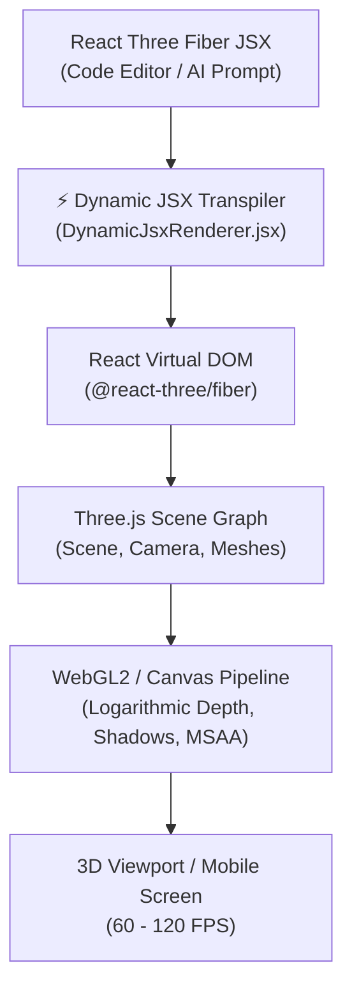
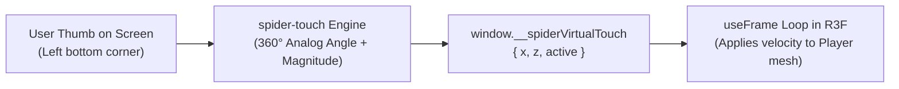

# 🎨 Spider Game Engine: Canvas & React Three Fiber (R3F) Developer Guide

> **The definitive manual for the 3D Canvas, WebGL rendering pipeline, dynamic JSX component compilation, and React Three Fiber architecture in Spider Engine.**

---

## 📑 Table of Contents
1. [Overview & Architecture](#1-overview--architecture)
2. [The 3D Canvas Setup & WebGL Pipeline](#2-the-3d-canvas-setup--webgl-pipeline)
3. [React Three Fiber (R3F) Core Concepts](#3-react-three-fiber-r3f-core-concepts)
4. [Dynamic JSX Compilation & Live Sandbox Mounting](#4-dynamic-jsx-compilation--live-sandbox-mounting)
5. [The 60–120 FPS High-Performance Game Loop (`useFrame`)](#5-the-60120-fps-high-performance-game-loop-useframe)
6. [Cameras, Viewports & Controls](#6-cameras-viewports--controls)
7. [Lighting, Soft Shadows & Post-Processing](#7-lighting-soft-shadows--post-processing)
8. [Mobile Touch Joystick System (`spider-touch`)](#8-mobile-touch-joystick-system-spider-touch)
9. [Troubleshooting & Best Practices](#9-troubleshooting--best-practices)

---

## 1. Overview & Architecture

Spider Game Engine combines the declarative simplicity of **React Three Fiber (R3F)** with real-time dynamic compilation and autonomous AI synthesis.



---

## 2. The 3D Canvas Setup & WebGL Pipeline

At the root of the rendering engine is the R3F `<Canvas>` component located in `src/engine/GameViewport.jsx` and `src/engine/DynamicJsxRenderer.jsx`.

### Core Canvas Configuration
```jsx
<Canvas
  shadows="soft"
  dpr={[1, 2]} // High-DPI support: scales dynamically between 1x and 2x
  gl={{
    antialias: true,
    powerPreference: "high-performance",
    logarithmicDepthBuffer: true, // Prevents Z-fighting on massive landscapes
    alpha: false,
    toneMapping: THREE.ACESFilmicToneMapping,
    toneMappingExposure: 1.15,
  }}
  camera={{ position: [0, 8, 14], fov: 50, near: 0.1, far: 2000 }}
>
  {/* Scene Graph */}
</Canvas>
```

### Key Parameters Explained
| Property | Value | Purpose |
| :--- | :--- | :--- |
| `logarithmicDepthBuffer` | `true` | Completely prevents flickering/Z-fighting when viewing distant mountains, skyboxes, and ground planes simultaneously. |
| `powerPreference` | `"high-performance"` | Requests the discrete GPU (NVIDIA / AMD) on laptops with dual graphics cards. |
| `dpr` | `[1, 2]` | Limits device pixel ratio to 2.0 max, saving battery and GPU thermals on 3x/4x mobile displays while remaining ultra-crisp. |
| `toneMapping` | `ACESFilmicToneMapping` | Provides cinematic, film-grade color reproduction without blown-out specular highlights. |

---

## 3. React Three Fiber (R3F) Core Concepts

React Three Fiber translates HTML-like JSX tags directly into Three.js object instances:
- `<mesh>` → `new THREE.Mesh()`
- `<boxGeometry args={[width, height, depth]} />` → `new THREE.BoxGeometry(width, height, depth)`
- `<meshStandardMaterial color="#3b82f6" />` → `new THREE.MeshStandardMaterial({ color: 0x3b82f6 })`

### Declarative Hierarchy Pattern
```jsx
function FloatingCrystal({ position = [0, 2, 0], color = "#06b6d4" }) {
  const meshRef = useRef();

  // Rotate every frame
  useFrame((state, delta) => {
    meshRef.current.rotation.y += delta * 1.5;
    meshRef.current.position.y = position[1] + Math.sin(state.clock.elapsedTime * 2) * 0.3;
  });

  return (
    <mesh ref={meshRef} position={position} castShadow receiveShadow>
      <octahedronGeometry args={[1, 0]} />
      <meshStandardMaterial
        color={color}
        roughness={0.1}
        metalness={0.8}
        emissive={color}
        emissiveIntensity={0.4}
      />
    </mesh>
  );
}
```

---

## 4. Dynamic JSX Compilation & Live Sandbox Mounting

Spider Engine allows users and AI agents to write pure JSX code in the **Code Editor** (`GameComponent.jsx`) and mounts it **instantly without page reload or rebuild**.

### How It Works Behind the Scenes
1. The source code is captured from the editor or AI tool `render_jsx`.
2. `DynamicJsxRenderer.jsx` transpiles the JSX into an executable React component in milliseconds using an optimized in-browser Babel/AST transformer.
3. Common R3F dependencies and helpers are injected automatically:
   - **R3F Hooks**: `useFrame`, `useThree`, `useLoader`
   - **Drei Components**: `OrbitControls`, `useFBX`, `useGLTF`, `useAnimations`, `Float`, `Text`, `Sky`, `Stars`, `Grid`, `Html`
   - **Three.js Core**: `THREE` namespace with all geometries, materials, vectors, and math utilities.
4. The compiled component is mounted inside a React `<Suspense>` boundary. If an error occurs, an in-viewport error overlay surfaces the exact line number with a 1-click AI auto-fix button.

---

## 5. The 60–120 FPS High-Performance Game Loop (`useFrame`)

In React Three Fiber, **never use `setInterval` or React `useState` for animation or per-frame movement**. That triggers React re-renders 60 times a second and causes stuttering.

Instead, use `useFrame`:

```jsx
import { useRef } from 'react';
import { useFrame } from '@react-three/fiber';

function Player({ speed = 12 }) {
  const playerRef = useRef();

  useFrame((state, delta) => {
    // 1. delta is frame time in seconds (e.g. 0.016s for 60fps)
    // Always multiply movement by delta for frame-rate independent gameplay!
    const moveStep = speed * delta;

    // 2. Access clock for smooth procedural waves/animations
    const t = state.clock.getElapsedTime();

    // 3. Mutate Three.js properties directly (Zero React overhead!)
    if (playerRef.current) {
      playerRef.current.position.x += moveStep * 0.1;
    }
  });

  return (
    <mesh ref={playerRef} position={[0, 1, 0]}>
      <sphereGeometry args={[0.5, 32, 32]} />
      <meshStandardMaterial color="#f59e0b" />
    </mesh>
  );
}
```

---

## 6. Cameras, Viewports & Controls

Spider Engine provides three primary camera configurations:

### 1. Orbit Controls (Editor & Inspection Mode)
```jsx
import { OrbitControls } from '@react-three/drei';

<OrbitControls
  makeDefault
  enableDamping
  dampingFactor={0.05}
  minDistance={2}
  maxDistance={200}
  maxPolarAngle={Math.PI / 2 - 0.02} // Prevent camera going underground
/>
```

### 2. Third-Person Chase Camera (Follow Player)
```jsx
useFrame(({ camera }) => {
  if (!playerRef.current) return;
  const p = playerRef.current.position;
  
  // Camera smooth-follows player with lerp
  const targetCamX = p.x;
  const targetCamY = p.y + 4.5;
  const targetCamZ = p.z + 8.5;

  camera.position.x += (targetCamX - camera.position.x) * 0.1;
  camera.position.y += (targetCamY - camera.position.y) * 0.1;
  camera.position.z += (targetCamZ - camera.position.z) * 0.1;
  camera.lookAt(p.x, p.y + 1.2, p.z);
});
```

### 3. Pointer Lock (FPS / Third Person Play Mode)
- **Shortcut**: Toggle play mode, then click inside the 3D viewport canvas.
- **Unlock**: Press **`Alt + Win + G`** or **`Escape`**.

---

## 7. Lighting, Soft Shadows & Post-Processing

A professional 3D environment requires balanced ambient, directional, and fill lighting:

```jsx
function StudioEnvironment() {
  return (
    <>
      {/* 1. Ambient skylight */}
      <ambientLight intensity={0.4} color="#f8fafc" />

      {/* 2. Main Sun / Key Light with Shadow Casting */}
      <directionalLight
        position={[30, 50, 25]}
        intensity={1.2}
        castShadow
        shadow-mapSize-width={2048}
        shadow-mapSize-height={2048}
        shadow-camera-near={0.5}
        shadow-camera-far={200}
        shadow-camera-left={-40}
        shadow-camera-right={40}
        shadow-camera-top={40}
        shadow-camera-bottom={-40}
        shadow-bias={-0.0005} // Eliminates shadow acne
      />

      {/* 3. Soft Sky Horizon & Atmosphere */}
      <Sky sunPosition={[30, 50, 25]} turbidity={8} rayleigh={2} />
      <fog attach="fog" args={["#e2e8f0", 40, 250]} />
    </>
  );
}
```

---

## 8. Mobile Touch Joystick System (`spider-touch`)

Spider Engine features a native mobile on-screen joystick that integrates seamlessly with your R3F components.



### Reading Touch Input in R3F Code
```jsx
useFrame((state, delta) => {
  const touch = (typeof window !== "undefined" && window.__spiderVirtualTouch) || {};
  if (touch.active) {
    // touch.x: -1.0 (full left) to +1.0 (full right)
    // touch.z: -1.0 (full down) to +1.0 (full up)
    playerRef.current.position.x += touch.x * speed * delta;
    playerRef.current.position.z += -touch.z * speed * delta;
  }
});
```

---

## 9. Troubleshooting & Best Practices

| Issue | Cause | Solution |
| :--- | :--- | :--- |
| **Black screen / blank viewport** | Component threw an error during render or unhandled promise in asset loader. | Wrap component in `<Suspense fallback={null}>` and check browser console (`F12`). |
| **Z-fighting / flickering textures** | Two planes placed at exact same position (e.g. `y=0`). | Set `logarithmicDepthBuffer: true` on Canvas and offset surfaces by `0.005` in Y. |
| **Severe frame drops on mobile** | High polygon count or too many distinct materials/draw calls. | Enable mesh instancing (`<instancedMesh>`), share materials, and keep `dpr={[1, 1.5]}` on mobile. |
| **Shadows cut off abruptly** | Shadow camera frustum is too small for scene size. | Increase `shadow-camera-left/right/top/bottom` on the main directional light. |
