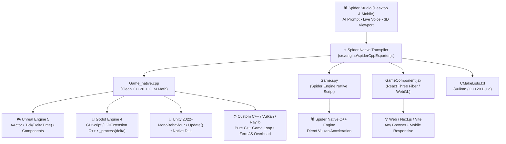

# 🚀 Spider Game Engine: Universal Cross-Engine Integration Guide

> **Export your Spider Engine games into Unreal Engine 5, Godot 4, Unity, or any Custom C++ Engine with 100% native performance.**

---

## 📖 Overview

Spider Game Engine serves as an **autonomous 3D prototyping and AI game design studio**. Developers use Spider Engine to design, voice-control, and test 3D games in seconds on desktop or mobile. 

Once your game is created, the built-in **Spider Native Transpiler** exports your code into clean, zero-overhead **native C++20**, **Spider SPY Language**, or **React Three Fiber JSX**, allowing you to deploy directly into production game engines:



---

## 📥 How to Download Exported Files

### On Desktop Studio
1. Open or generate your game in Spider Game Engine.
2. In the top Viewport toolbar, click the **`Export ▾`** dropdown menu.
3. Select any export option:
   - 📥 **Download JSX (`.jsx`)** — Standalone React Three Fiber source.
   - ⚡ **Export Native C++ (`.cpp`)** — Transpiled C++20 game scene.
   - ✨ **Export SPY Script (`.spy`)** — Spider Engine native script.
   - 📄 **Export CMakeLists.txt** — Ready-to-build C++ CMake project.
4. *Alternatively*, switch to **Code Mode** (`Code` button) and click the **`JSX`**, **`C++`**, or **`SPY`** buttons next to `Save`.

### On Pocket Studio Mobile
1. Tap the **🪄 (Wand)** button or open the File Menu in the Code tab.
2. Tap **Download JSX**, **Export Native C++**, or **Export SPY Script**.
3. Files will download directly to your mobile device or desktop `Downloads` folder.

---

## 🎮 1. Unreal Engine 5 (UE5 / UE4)

Unreal Engine uses C++ Actors with `Tick(float DeltaTime)` which matches Spider Engine's `Update(float deltaTime)` and `useFrame` loops 1:1.

### Step-by-Step Integration:

#### Step 1: Create the C++ Class
1. Open your Unreal Engine project.
2. In the top menu bar, click **Tools** → **New C++ Class...**
3. Select **Actor** (or **Character** if you want built-in humanoid physics) and click **Next**.
4. Name the class `SpiderGameActor` and click **Create Class**.
5. Unreal Engine will automatically create:
   - `Source/<YourProject>/SpiderGameActor.h`
   - `Source/<YourProject>/SpiderGameActor.cpp`

#### Step 2: Update Header (`SpiderGameActor.h`)
Replace the contents of `SpiderGameActor.h` with:
```cpp
#pragma once

#include "CoreMinimal.h"
#include "GameFramework/Actor.h"
#include "Components/StaticMeshComponent.h"
#include "SpiderGameActor.generated.h"

UCLASS()
class YOURPROJECT_API ASpiderGameActor : public AActor {
    GENERATED_BODY()

public:
    ASpiderGameActor();

protected:
    virtual void BeginPlay() override;

public:
    virtual void Tick(float DeltaTime) override;

    // 3D Visual Mesh (maps from Spider Engine <mesh>)
    UPROPERTY(VisibleAnywhere, BlueprintReadOnly, Category = "Spider Engine")
    UStaticMeshComponent* HeroMesh;

    // Game State Variables (mapped from Spider Engine useState)
    UPROPERTY(EditAnywhere, BlueprintReadWrite, Category = "Spider Engine")
    float MoveSpeed = 600.0f;

    UPROPERTY(VisibleAnywhere, BlueprintReadOnly, Category = "Spider Engine")
    int32 Score = 0;

    UPROPERTY(EditAnywhere, BlueprintReadWrite, Category = "Spider Engine")
    FVector Velocity = FVector::ZeroVector;
};
```

#### Step 3: Update Implementation (`SpiderGameActor.cpp`)
Replace `SpiderGameActor.cpp` with:
```cpp
#include "SpiderGameActor.h"

ASpiderGameActor::ASpiderGameActor() {
    PrimaryActorTick.bCanEverTick = true;

    // Create and attach mesh component
    HeroMesh = CreateDefaultSubobject<UStaticMeshComponent>(TEXT("HeroMesh"));
    RootComponent = HeroMesh;
}

void ASpiderGameActor::BeginPlay() {
    Super::BeginPlay();
    // One-time setup logic from Spider Engine's exported Init()
    Score = 0;
}

void ASpiderGameActor::Tick(float DeltaTime) {
    Super::Tick(DeltaTime);

    // Direct 1:1 translation from Spider Engine Update(dt) / useFrame:
    FVector CurrentLocation = GetActorLocation();

    // Example: translate Math.sin / Math.cos to FMath::Sin / FMath::Cos
    float TimeSeconds = GetWorld()->GetTimeSeconds();
    CurrentLocation.Z += FMath::Sin(TimeSeconds * 3.0f) * 20.0f * DeltaTime;

    SetActorLocation(CurrentLocation);
}
```

#### Step 4: Compile & Run in Level
1. In Unreal Engine 5, click the **Live Coding** button at the bottom right (`Ctrl + Alt + F11`) or press Build in Visual Studio.
2. In the **Content Drawer** (`Ctrl + Space`), go to **C++ Classes** → **YourProject** → drag `SpiderGameActor` into your level viewport.
3. Assign any Static Mesh (e.g. `SM_ChamferCube` or `SM_Sphere`) in the Details panel.
4. Press **Play (`Alt + P`)**!

---

## 🤖 2. Godot Engine 4 (GDScript / C# / GDExtension)

Godot's `Node3D` and `_process(delta)` match Spider Engine's React Three Fiber `<group>` and `useFrame` loop.

### Option A: GDScript (Instant Copy & Paste)

#### Step 1: Create the Scene
1. Open your Godot 4 project.
2. In the **Scene** dock, click **3D Scene** (creates a `Node3D` root).
3. Right-click `Node3D` → **Add Child Node** (`Ctrl + A`) → select `MeshInstance3D` (name it `HeroMesh`).
4. In the Inspector on the right, under **Mesh**, assign a **New BoxMesh** or **New SphereMesh**.

#### Step 2: Attach Script
1. Right-click the root `Node3D` → click **Attach Script** → name it `SpiderGame.gd`.
2. Paste the following script:
```gdscript
extends Node3D

# State variables (from Spider Engine useState)
var score: int = 0
var hero_pos: Vector3 = Vector3(0.0, 0.5, 0.0)
@export var speed: float = 8.0

func _ready() -> void:
    print("Spider Game initialized in Godot 4!")

func _process(delta: float) -> void:
    # Direct 1:1 match with Spider Engine's exported Update(dt) / useFrame:
    var dir = Input.get_vector("ui_left", "ui_right", "ui_up", "ui_down")
    hero_pos.x += dir.x * speed * delta
    hero_pos.z += dir.y * speed * delta

    if has_node("HeroMesh"):
        $HeroMesh.position = hero_pos
```

#### Step 3: Run
1. Press `Ctrl + S` and save as `SpiderGame.tscn`.
2. Press **F6** to run the scene immediately!

---

## 🎯 3. Unity (Unity 2022+ / C# / URP / HDRP)

Unity's `MonoBehaviour.Update()` maps directly to the Spider Engine frame loop.

### Step-by-Step Integration:

#### Step 1: Create the C# Script
1. In Unity's Project window, open `Assets/Scripts/` (create folder if needed).
2. Right-click → **Create** → **C# Script** → name it `SpiderGameController`.

#### Step 2: Paste the Code
Double-click `SpiderGameController.cs` and paste:
```csharp
using UnityEngine;

public class SpiderGameController : MonoBehaviour {
    [Header("State (from Spider Engine useState)")]
    public int score = 0;
    public float moveSpeed = 8.0f;
    public Transform heroTransform;

    void Start() {
        // One-time setup matching Spider Engine Init()
        Debug.Log("Spider Engine controller mounted in Unity!");
    }

    void Update() {
        float dt = Time.deltaTime;

        // 1:1 mapping from Spider Engine's exported Update(dt) / useFrame:
        float moveX = Input.GetAxis("Horizontal");
        float moveZ = Input.GetAxis("Vertical");

        if (heroTransform != null) {
            heroTransform.position += new Vector3(moveX, 0, moveZ) * moveSpeed * dt;
        }
    }
}
```

#### Step 3: Setup Scene & Run
1. In the Hierarchy, right-click → **3D Object** → **Cube** (name it `HeroCube`).
2. Right-click → **Create Empty** → name it `GameManager`.
3. Drag `SpiderGameController.cs` onto `GameManager`.
4. Drag `HeroCube` into the **Hero Transform** slot in the Inspector.
5. Click **Play (▶)** (`Ctrl + P`)!

---

## ⚙️ 4. Custom C++ Engines (Vulkan, OpenGL, Raylib, O3DE, Flax)

The exported `_native.cpp` is 100% standard **C++20** with `<cmath>`, `<vector>`, and GLM math. It has zero dependencies on Electron or Node.js.

### Building with CMake:
1. Place `YourGame_native.cpp` into `src/main.cpp`.
2. Place the exported `CMakeLists.txt` into the root directory.
3. Build with any C++20 compiler:
   ```bash
   mkdir build && cd build
   cmake ..
   cmake --build . --config Release
   ./Release/SpiderGame.exe
   ```

### Using in a Raylib / Custom Window Loop:
```cpp
#include "raylib.h"
#include <cmath>

int main() {
    InitWindow(1280, 720, "Spider Game - Native C++ Raylib");
    SetTargetFPS(60);

    Vector3 heroPos = { 0.0f, 0.5f, 0.0f };
    float speed = 8.0f;

    while (!WindowShouldClose()) {
        float dt = GetFrameTime();

        // 1:1 match with Spider Engine's exported Update(dt) loop:
        if (IsKeyDown(KEY_RIGHT) || IsKeyDown(KEY_D)) heroPos.x += speed * dt;
        if (IsKeyDown(KEY_LEFT) || IsKeyDown(KEY_A))  heroPos.x -= speed * dt;
        if (IsKeyDown(KEY_DOWN) || IsKeyDown(KEY_S))  heroPos.z += speed * dt;
        if (IsKeyDown(KEY_UP) || IsKeyDown(KEY_W))    heroPos.z -= speed * dt;

        BeginDrawing();
        ClearBackground(RAYWHITE);
        // Draw 3D scene matching exported geometries
        DrawCube(heroPos, 1.0f, 1.0f, 1.0f, BLUE);
        DrawGrid(20, 1.0f);
        EndDrawing();
    }

    CloseWindow();
    return 0;
}
```

---

## 🌐 5. Standalone Web / Next.js / Vite Projects

If you downloaded the `.jsx` file:
1. Copy `YourGameComponent.jsx` into your React project.
2. Install standard React Three Fiber dependencies:
   ```bash
   npm install three @react-three/fiber @react-three/drei
   ```
3. Import and render:
   ```jsx
   import React from "react";
   import { Canvas } from "@react-three/fiber";
   import GameComponent from "./YourGameComponent.jsx";

   export default function App() {
     return (
       <div style={{ width: "100vw", height: "100vh", background: "#050811" }}>
         <Canvas shadows camera={{ position: [0, 8, 12], fov: 50 }}>
           <GameComponent />
         </Canvas>
       </div>
     );
   }
   ```

---

## 🕷️ 6. Upcoming Spider Game Engine Native Runtime (SPY Language)

Games exported as `.spy` run directly on the upcoming Spider Game Engine C++ native runtime with raw Vulkan acceleration and zero browser overhead:

```bash
spider-engine run YourGame.spy --vulkan
```

---

## 📊 Quick Translation Reference Table

| Concept in Spider Engine JSX | Unreal Engine 5 | Godot 4 | Unity | Custom C++ (GLM) |
| :--- | :--- | :--- | :--- | :--- |
| **State** (`useState(0)`) | `int32 Score = 0;` | `var score: int = 0` | `public int score = 0;` | `int score = 0;` |
| **Transform** (`position={[x,y,z]}`) | `FVector(x, y, z)` | `Vector3(x, y, z)` | `Vector3(x, y, z)` | `glm::vec3(x, y, z)` |
| **Game Loop** (`useFrame((_, dt) => {})`) | `Tick(float DeltaTime)` | `_process(delta)` | `Update()` (`Time.deltaTime`) | `Update(float dt)` |
| **Box Mesh** (`<boxGeometry args={[w,h,d]} />`) | `UStaticMeshComponent` (Cube) | `MeshInstance3D` (`BoxMesh`) | `Cube` Primitive / `MeshFilter` | `CreateBoxGeometry(w, h, d)` |
| **Color** (`color="#3b82f6"`) | `FLinearColor(0.23, 0.51, 0.96)` | `Color("#3b82f6")` | `Color(0.23f, 0.51f, 0.96f)` | `glm::vec4(0.23f, 0.51f, 0.96f, 1.0f)` |
| **Math Functions** (`Math.sin`, `Math.atan2`) | `FMath::Sin`, `FMath::Atan2` | `sin()`, `atan2()` | `Mathf.Sin`, `Mathf.Atan2` | `std::sin`, `std::atan2` |
